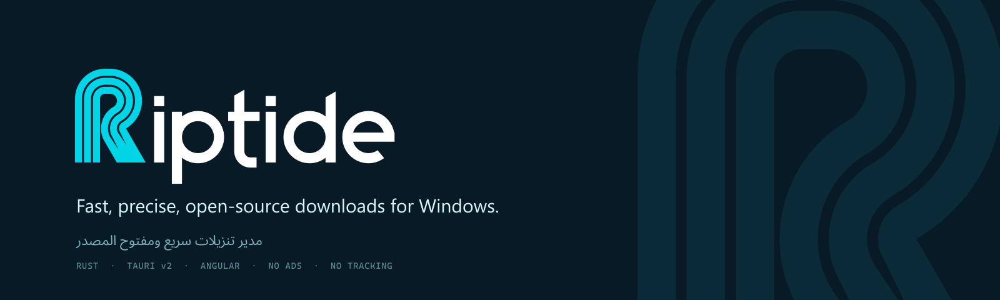
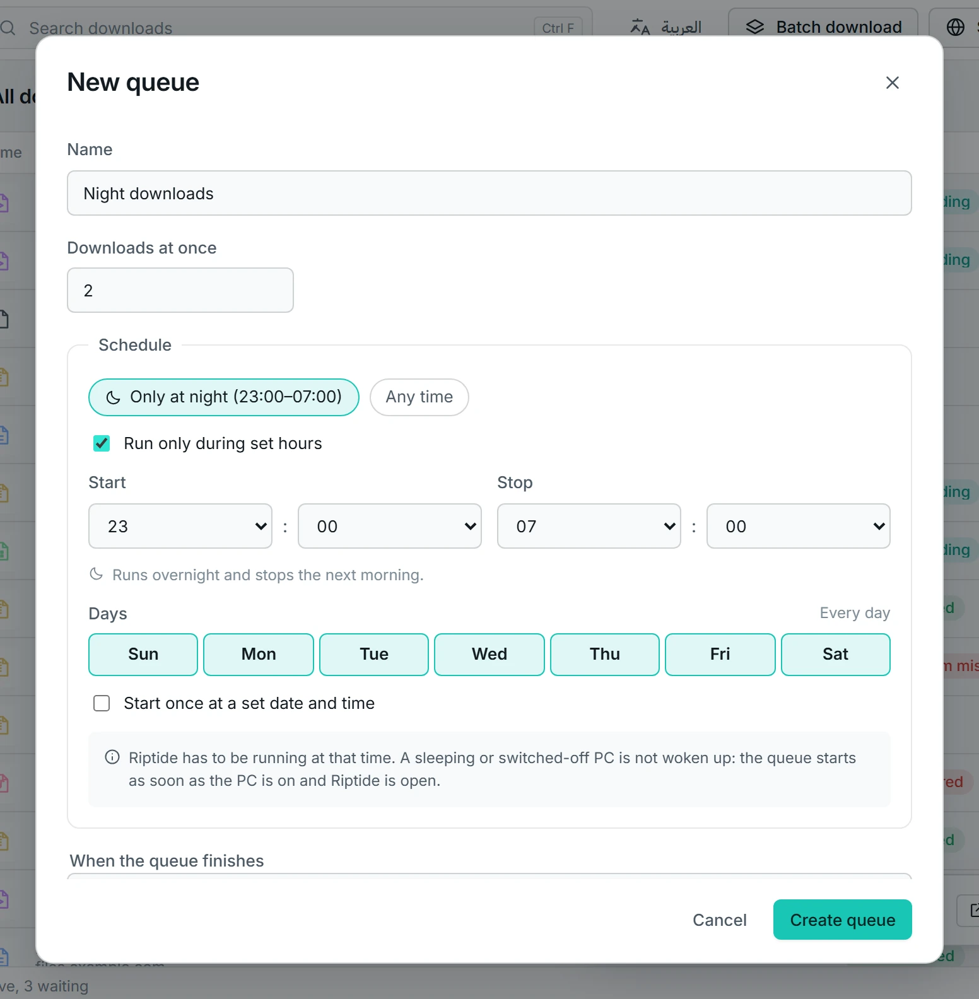

<p align="center">
  
</p>

<p align="center">
  <a href="https://github.com/LayanJarrar1/Riptide/releases"></a>
  <a href="https://github.com/LayanJarrar1/Riptide/releases"></a>
  <a href="https://github.com/LayanJarrar1/Riptide/stargazers"></a>
  
  
  
  <a href="#license"></a>
</p>

<h3 align="center">Download faster. Every byte verified.<br>A free, open-source download manager. Parallel connections, exact resume, SHA-256 checks.</h3>

<p align="center">
  <a href="#download"><b>Download</b></a> ·
  <a href="https://layanjarrar1.github.io/Riptide/">Website</a> ·
  <a href="#whats-new-in-alpha-4">What's new</a> ·
  <a href="#browser-extension">Browser extension</a> ·
  <a href="#features">Features</a> ·
  <a href="#riptide-vs-idm">Riptide vs IDM</a> ·
  <a href="#how-it-works">How it works</a> ·
  <a href="#build-from-source">Build</a> ·
  <a href="#بالعربي">بالعربي</a>
</p>

> [!NOTE]
> **Riptide is in alpha.** It is solid enough to try and to report bugs against, but it is not finished.
> Keep important downloads in your current tool for now, and expect changes between releases.

---

Riptide is a **free, open-source download manager for Windows**: the open alternative to Internet
Download Manager. It splits every file across many connections, resumes from the exact byte after a crash or
a power cut, pulls video from video sites, runs queues on a schedule, takes downloads straight from your
browser, and speaks **Arabic and English** with a fully mirrored right-to-left interface.

No license fee. No ads, nag screens or trial timers. No account. No telemetry. No administrator rights.

<p align="center">
  
</p>
<p align="center"><sub>Every stripe in a progress bar is one connection. Red stripes mark a file that failed its checksum.</sub></p>

## What's new in alpha 4

- **Video pages** from YouTube, Vimeo and more, with a quality picker (down to 144p, or audio only as M4A or MP3)
- **Queues with schedules** and finish actions: exit, sleep, hibernate, shut down or run a program
- **Batch downloads** from patterns such as `file[001-120].zip`, and a **site grabber** that respects `robots.txt`
- **Browser extension:** download this video, all or selected links and all images, capture rules, and a one-click install helper for Chrome and Edge
- **Update notifications**, a badge in Settings and a "What's new" link after updating
- **New look:** the Riptide brand, with a new logo, icons and website

Full notes: [release 0.1.0-alpha.4](https://github.com/LayanJarrar1/Riptide/releases/tag/v0.1.0-alpha.4).

<table>
  <tr>
    <td width="50%"></td>
    <td width="50%"></td>
  </tr>
  <tr>
    <td align="center"><sub><b>Video:</b> pick a quality, including audio-only.</sub></td>
    <td align="center"><sub><b>Batch:</b> a pattern becomes a checked list of links.</sub></td>
  </tr>
  <tr>
    <td width="50%"></td>
    <td width="50%"></td>
  </tr>
  <tr>
    <td align="center"><sub><b>Queues:</b> schedule them, then choose what happens next.</sub></td>
    <td align="center"><sub><b>Site grabber:</b> files found on a site, grouped by type.</sub></td>
  </tr>
</table>

<sub>Video support uses [yt-dlp](https://github.com/yt-dlp/yt-dlp) and [FFmpeg](https://ffmpeg.org), shipped as separate programs
next to Riptide. Websites change often, so *Settings → About → Update video support* fetches the newest yt-dlp when you ask.
Live streams, playlists and DRM-protected videos are refused. Only download what you have the right to download.</sub>

## Download

| | File | Notes |
|---|---|---|
| **Installer** | [`Riptide_0.1.0-alpha.4_x64-setup.exe`](https://github.com/LayanJarrar1/Riptide/releases/download/v0.1.0-alpha.4/Riptide_0.1.0-alpha.4_x64-setup.exe) | Per-user install, no admin prompt |
| **Portable** | [`Riptide-0.1.0-alpha.4-portable.zip`](https://github.com/LayanJarrar1/Riptide/releases/download/v0.1.0-alpha.4/Riptide-0.1.0-alpha.4-portable.zip) | Unzip anywhere; data stays next to the app |

**Requirements:** Windows 10 or 11, 64-bit. WebView2 is already part of Windows.
All builds and their SHA-256 checksums are on the [Releases page](https://github.com/LayanJarrar1/Riptide/releases).

**Always up to date.** Riptide checks GitHub Releases at most once a day (you can turn it off in Settings) and shows a
notification when a new version exists. One click installs it, and updates are signed. That check is the only network
call besides your downloads.

> [!TIP]
> The alpha is not code-signed yet, so Windows SmartScreen may warn the first time. Choose **More info** →
> **Run anyway**. Every file's SHA-256 is listed in `SHA256SUMS.txt` on the release.

## Browser extension

The extension takes downloads from **Chrome, Edge and Firefox** and hands them to Riptide, with the page's
cookies and referrer, so links that need a login keep working. If Riptide is closed, the extension starts it.
If anything goes wrong, the browser simply downloads the file itself; nothing is lost.

- **Automatic capture**, with rules: minimum size, file types, sites to always or never use, hold **Alt** to skip.
- **Right-click** *Download with Riptide* on any link, image, video or audio, or grab **all links**, **selected links** or **all images** on a page.
- **A video button** on video pages with a quality picker, and a small button on direct file links.

### Chrome or Edge: install in 3 steps

The extension is not in the Chrome Web Store or Edge Add-ons yet (store listings are coming), so load it once by hand.

1. In Riptide open **Settings → Integration** and press **Open extension folder**.
2. In the browser open `chrome://extensions` (`edge://extensions` in Edge) and turn on **Developer mode**.
3. Press **Load unpacked** and pick that folder.

The folder is `extension\chrome` (or `extension\edge`) inside the Riptide install folder, by default `%LOCALAPPDATA%\Riptide`; for the portable zip it sits next to the app.

Firefox: `about:debugging` → *This Firefox* →
*Load Temporary Add-on* → `extension\firefox\manifest.json`. Building it yourself: `cd apps/extension && npm ci && npm run build`.
Permissions, privacy and how it talks to the app: [`apps/extension/README.md`](apps/extension/README.md).

## Screenshots

<p align="center">
  
</p>
<p align="center"><sub>Arabic and the dark theme. The whole layout mirrors, instantly, and you can switch language while downloads run.</sub></p>

## Features

**Speed**
- Multi-connection downloads (1 to 32) with **work stealing**: when a connection finishes early it takes half
  of the slowest remaining part, so the link stays saturated to the last byte.
- A per-server connection cap so hosts don't block you. If a server answers *429* or *503*, Riptide uses fewer
  connections on that host from then on, and retries with back-off and `Retry-After`.
- A speed limit for everything or for a single download, and proxy support.

**Reliability**
- **Byte-exact resume.** Pause any time; resume continues from the exact byte, and only if the server still
  serves the same file. If it changed, Riptide starts over instead of mixing two versions.
- **Crash-proof.** Progress is saved to a local database every second. Kill the app or lose power, and every
  download continues on the next start.
- **Checksum verification** (MD5, SHA-1, SHA-256), and *Restart from the beginning* when you need a clean copy.

**Organised**
- Video pages through yt-dlp, batch downloads from patterns or pasted lists, and a site grabber that crawls to a chosen depth.
- Queues with schedules and finish actions, categories by file type with their own folders, duplicate detection
  before adding, and real free-space checks with a warning when a file won't fit.
- Search, sort, filter, multi-select, a details drawer, and full keyboard control (press `?` for shortcuts).
- Close to the tray, start with Windows, completion notifications, and a clipboard watcher if you want one.

**Safe and private**
- File names from servers are sanitised and can never escape your folder. Redirects are capped. Cookies and
  passwords are only sent to the site they belong to, never logged, and deleted when the download ends.
- The browser can only ask: the extension talks to a small local helper that accepts a short list of message
  types and checks who is calling. Nothing from a web page is ever executed.
- No admin rights, no account, no telemetry. The only network traffic is your downloads and, if you leave it on,
  one update check against GitHub Releases, at most once a day.

**Yours**
- Arabic and English everywhere, auto-detected and switchable live, with a mirrored RTL layout and
  correct Arabic file names. Light and dark themes. Respects reduced-motion settings.
- A portable mode for USB drives, and a command-line tool for scripts: `riptide fetch`, `riptide batch`
  and `riptide grab`.

## Riptide vs IDM

| | **Riptide** | IDM |
|---|---|---|
| Price | **Free, forever** | Paid license per PC |
| Source code | **Open** (GPL-3.0 app, MIT / Apache-2.0 engine) | Closed |
| Ads, trial reminders, activation | **None** | Trial reminders, serial activation |
| Administrator rights | **Never needed** | Standard installer |
| Arabic interface | **Fully mirrored RTL** | Translated strings |
| Multi-connection downloads | Yes, with work stealing | Yes |
| Queues and scheduler | Yes | Yes |
| Batch downloads and site grabber | Yes | Yes |
| Browser integration | Chrome, Edge, Firefox | Chrome, Edge, Firefox and more |
| Resume after crash or power loss | Database checkpoints every second | Resume support |
| Built-in checksum verification | **Yes** (MD5, SHA-1, SHA-256) | No |
| Maturity | Alpha | Shipping for many years |

<sub>IDM is a trademark of Tonec Inc. The comparison reflects publicly documented behaviour at the time of
writing. If a row is wrong, please open an issue.</sub>

## How it works

1. **Probe.** Riptide asks the server for the file's size, final address, name, and whether it supports
   partial downloads. For a video page it asks yt-dlp for the title and the qualities on offer.
2. **Split.** The file is cut into equal parts, one per connection, and space for the whole file is reserved on
   disk as `name.rtpart`.
3. **Pull.** Each connection fetches its part and writes it straight into place. Idle connections take work
   from slow ones.
4. **Checkpoint.** Every second, each part's progress is written to a local SQLite database in one transaction.
5. **Verify and finish.** The size and optional checksum are checked, then the file gets its final name in one
   atomic step. There is no "assembling" wait at the end.

The browser extension talks to a tiny local helper (`riptide-host`) that forwards only a short list of safe
requests to the app over a private, per-user channel. The full picture is in
[ARCHITECTURE.md](ARCHITECTURE.md).

### Measured

On a Windows Server 2022 machine, release build, 32 downloads in the list: the window is ready in **899 ms**
(average of three cold starts), idle CPU is **0 %**, and the app process uses **35 MB** (plus WebView2). A batch of
120 files from the local test server finishes with every SHA-256 matching its source. These are
development-machine numbers, not promises for yours; `riptide bench` measures your own.

## Documentation

| | |
|---|---|
| [User guide (English)](guide/en.md) · [دليل الاستخدام](guide/ar.md) | Adding downloads, details, settings, shortcuts, portable mode, troubleshooting |
| [Browser extension](apps/extension/README.md) | Install, permissions, privacy, how it talks to the app |
| [Architecture](ARCHITECTURE.md) | Crates, life of a download, guarantees, testing |
| [Contributing](CONTRIBUTING.md) | Setup, the quality gate, conventions, pull requests |
| [Security policy](SECURITY.md) | Private reporting and what Riptide guards against |
| [Changelog](CHANGELOG.md) | What changed |

## Build from source

You need stable Rust (`rustup`), Node.js 20+, and Visual Studio Build Tools with the C++ workload. No admin
rights are needed for any of it.

```powershell
git clone https://github.com/LayanJarrar1/Riptide.git
cd Riptide

# run the desktop app in development mode
cd apps\desktop
npm install
node scripts\fetch-media-tools.mjs   # video support: pinned yt-dlp and FFmpeg, SHA-256 checked
npm run tauri dev

# build the installer and the portable zip
npm run bundle
npm run bundle:portable

# the quality gate: lint, build and every test (run from the repository root)
.\scripts\check.ps1
```

Engine tests run against a local test server that fakes every way a download can go wrong (dropped
connections, flaky servers, files that change mid-download, wrong lengths, expired links, hostile file names,
a small crawlable site), and every resume test compares the SHA-256 of the result with the source. More in
[CONTRIBUTING.md](CONTRIBUTING.md).

<details>
<summary><b>Repository layout</b></summary>

```
crates/
  riptide-core/        download model, state machine, segment planner, queues and schedules, batch patterns
  riptide-net/         HTTP engine: probe, ranges, multi-connection transfer, retry, auth, redirects
  riptide-store/       SQLite persistence and migrations
  riptide-engine/      runtime: queues, scheduler, crash recovery, events, disk space
  riptide-media/       video pages through yt-dlp: probe, quality menu, progress, resume
  riptide-crawl/       site grabber: depth, scope, robots.txt, filters
  riptide-ipc/         private per-user pipe and message schema
  riptide-host/        browser Native Messaging host
  riptide-log/         logging with secret redaction, installed and portable paths
  riptide-cli/         command-line client (riptide fetch / batch / grab / bench)
  riptide-testserver/  local server with every failure mode the tests need
apps/
  desktop/             Tauri v2 shell (src-tauri) and the Angular interface (src)
  extension/           Manifest V3 extension for Chrome, Edge and Firefox
  website/             the product website (static, bilingual)
guide/                 user guide in English and Arabic
scripts/check.ps1      the quality gate
```

</details>

## بالعربي

**ريبتايد** مدير تحميل مجاني ومفتوح المصدر لويندوز، والبديل المفتوح لبرنامج IDM. يقسم كل ملف على اتصالات
متعددة، ويكمل من البايت الذي توقف عنده بالضبط، ويصمد أمام انطفاء الجهاز أو تعطّل البرنامج، ويلتقط التحميلات
مباشرة من المتصفح عبر إضافة لكروم وإيدج وفايرفوكس.

- **مجاني بالكامل:** بدون رخصة، بدون إعلانات، بدون حساب، بدون تتبّع، وبدون صلاحيات مسؤول.
- **عربي من أول يوم:** واجهة معكوسة بالكامل من اليمين لليسار، وتبديل فوري بين العربية والإنجليزية، وأسماء الملفات
  العربية تصل إلى القرص صحيحة.
- **دقيق حتى آخر بايت:** لا يعتبر التحميل مكتملًا إلا إذا وصلت كل القطع، وطابق الملف بصمته إن أعطيته واحدة.

**الجديد في النسخة 4:** تحميل الفيديو من يوتيوب وفيميو وغيرهما من المواقع التي يدعمها yt-dlp مع اختيار الجودة (حتى الصوت فقط)، وطوابير بجداول
زمنية مع خيار «عند الانتهاء» (إغلاق أو سكون أو إيقاف التشغيل) بعدّ تنازلي لثلاثين ثانية، وتحميل دفعات بنمط مثل
`file[001-120].zip`، وجامع الملفات الذي يمرّ على موقع كامل ويحترم `robots.txt`، وزرّ «حمّل هذا الفيديو» في المتصفح،
وإشعارات بالتحديثات الجديدة.

**محدَّث دائمًا:** يتحقق ريبتايد من إصدارات GitHub مرة واحدة في اليوم على الأكثر (ويمكنك إيقاف ذلك من الإعدادات)، ويُشعرك حين يتوفر إصدار جديد، وبنقرة واحدة يثبّته. التحديثات موقَّعة، وهذا الفحص هو الاتصال الوحيد غير تنزيلاتك.

**التحميل:** [المثبّت](https://github.com/LayanJarrar1/Riptide/releases/download/v0.1.0-alpha.4/Riptide_0.1.0-alpha.4_x64-setup.exe) ·
[النسخة المحمولة](https://github.com/LayanJarrar1/Riptide/releases/download/v0.1.0-alpha.4/Riptide-0.1.0-alpha.4-portable.zip) ·
[دليل الاستخدام بالعربية](guide/ar.md)

**تثبيت الإضافة في Chrome أو Edge بثلاث خطوات:** ١) في ريبتايد افتح **الإعدادات ← التكامل** واضغط **فتح مجلد الإضافة**.
٢) في المتصفح افتح `chrome://extensions` (أو `edge://extensions` في Edge) وفعّل **وضع المطوّر**.
٣) اضغط **تحميل إضافة غير مضغوطة** واختر ذلك المجلد. الإضافة ليست في المتاجر بعد (قريبًا)، ولذلك تحتاج هذه الخطوات مرة واحدة فقط.

> **ملاحظة:** هذه نسخة تجريبية (Alpha) للتجربة والإبلاغ عن الأخطاء، وليست نهائية بعد.

## Contributing

Bug reports with steps to reproduce, fixes with tests, and translation review are the most useful
contributions right now. Start with [CONTRIBUTING.md](CONTRIBUTING.md). Security issues go through
[SECURITY.md](SECURITY.md), not the public tracker.

## License

The desktop app, CLI, IPC crate, native host and browser extension are licensed under
**GPL-3.0-or-later** ([`LICENSE`](LICENSE)). The engine crates (`riptide-core`, `riptide-net`,
`riptide-store`, `riptide-engine`, `riptide-media`, `riptide-crawl`, `riptide-log`, `riptide-testserver`) are dual-licensed
**MIT OR Apache-2.0** ([`LICENSE-MIT`](LICENSE-MIT), [`LICENSE-APACHE`](LICENSE-APACHE)).

Built on [Tauri](https://tauri.app), [Angular](https://angular.dev), [tokio](https://tokio.rs),
[reqwest](https://github.com/seanmonstar/reqwest) and [rusqlite](https://github.com/rusqlite/rusqlite).
Ships [IBM Plex Sans Arabic](https://github.com/IBM/plex) and [Inter](https://rsms.me/inter/) under the SIL
Open Font License. Video support bundles [yt-dlp](https://github.com/yt-dlp/yt-dlp) (Unlicense) and an
[FFmpeg](https://ffmpeg.org) LGPL build as separate programs; their licenses are in the `licenses` folder next to the app.
