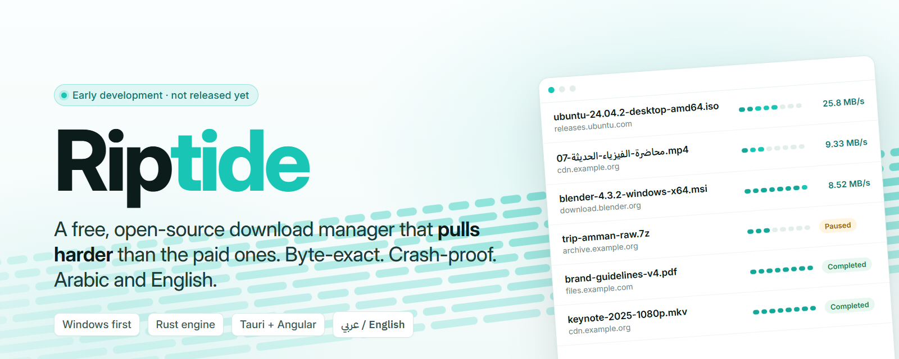
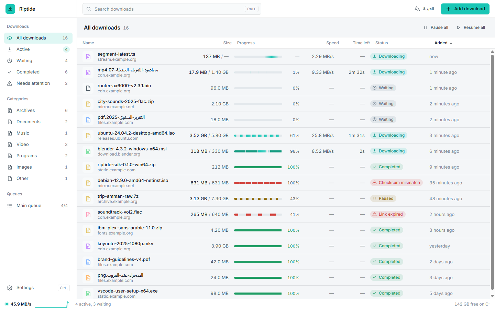
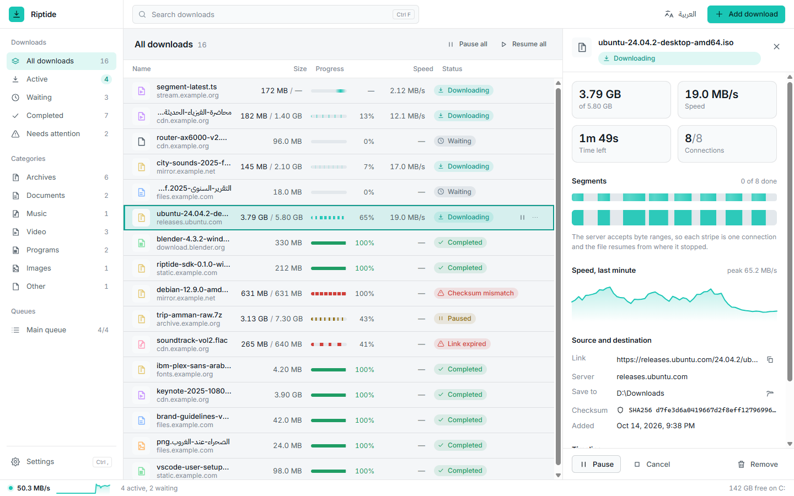
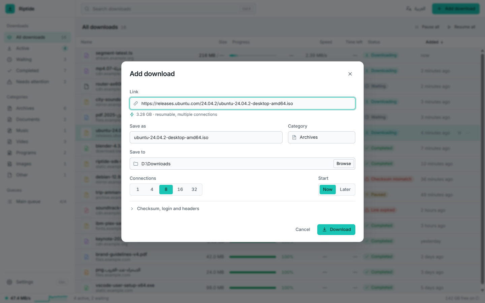
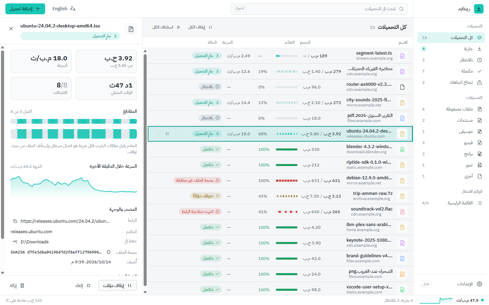
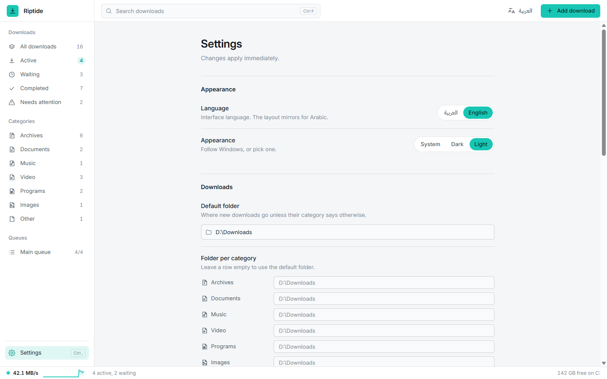

<p align="center">
  
</p>

<p align="center">
  <a href="#status"></a>
  <a href="https://github.com/LayanJarrar1/Riptide/stargazers"></a>
  <a href="https://github.com/LayanJarrar1/Riptide/commits/main"></a>
  
  
  
  
  <a href="#license"></a>
</p>

<p align="center">
  <a href="#overview">Overview</a> ·
  <a href="#status">Status</a> ·
  <a href="#screenshots">Screenshots</a> ·
  <a href="#highlights">Highlights</a> ·
  <a href="#riptide-and-idm">Riptide and IDM</a> ·
  <a href="#how-it-works">How it works</a> ·
  <a href="#documentation">Documentation</a> ·
  <a href="#build-from-source">Build</a> ·
  <a href="#بالعربي">بالعربي</a>
</p>

> [!WARNING]
> **Riptide is in early development and is not ready to use yet.**
> There are no releases, no installer and no stability promises. Everything on this page comes from a
> work-in-progress build that changes daily. Star or watch the repository to follow along.

## Overview

Riptide is a **free, open-source download manager for Windows**, built as the alternative to paid
download managers: the same multi-connection speed, proper resume and browser-grade reliability, without
the license fee, the ads, the nag screens or the telemetry.

It has two parts. A **Rust engine** that treats every byte as sacred: segmented, multi-connection
transfers with work stealing, byte-exact resume with server validators, checksum verification, and
progress checkpointed to SQLite every second so a crash or a power cut never costs more than a moment.
And a **desktop app** (Tauri v2 + Angular) that is **Arabic and English from day one**, with a fully
mirrored right-to-left layout, dark and light themes, and a dense, keyboard-friendly list that stays smooth
with a thousand items.

Windows comes first. The engine has no platform-specific code outside a few small modules, so other
platforms can follow.

## Status

| Area | Where it stands |
|---|---|
| Engine | Probe, segmented transfer, work stealing, retry, auth, redirects, resume, checksum, sparse part files, crash recovery. Tested against a local server that fakes every failure mode. |
| Runtime | Queue with a concurrency limit, scheduler, settings, event stream, graceful shutdown. |
| Desktop app | Real engine inside the app. List, details, add dialog, settings, Arabic/English, dark/light. |
| Command line | `riptide fetch` (standalone download with resume), `bench`, `ping`, `paths`. |
| Browser integration, media, torrents | Part of the product's direction; nothing to install today. |
| Installer and releases | None yet. |

The full list of what exists is in the [changelog](CHANGELOG.md).

## Screenshots

Light theme, current development build. The dark theme is the default.

<p align="center">
  
</p>
<p align="center"><sub>The list. Every stripe in a progress bar is one connection. Red stripes mark a file that failed its checksum.</sub></p>

<br>

<p align="center">
  
</p>
<p align="center"><sub>Details. Eight connections, a live segment map, the last minute of speed, and the checksum the file must match.</sub></p>

<br>

<p align="center">
  
</p>
<p align="center"><sub>Add a download. Riptide probes the link while you type: name, size, category, and whether the server allows resuming.</sub></p>

<br>

<p align="center">
  
</p>
<p align="center"><sub>The same screen in Arabic. The layout mirrors, numbers and file names stay readable, and the switch is instant.</sub></p>

<br>

<p align="center">
  
</p>
<p align="center"><sub>Settings. Changes apply immediately.</sub></p>

## Highlights

- **Pulls harder.** A file is split into segments and fetched over many connections at once. When one
  connection finishes early it steals work from the slowest one, so the link stays saturated to the last
  byte. A per-server cap keeps hosts from blocking you.
- **Byte-exact or nothing.** A download counts as complete only when every segment is on disk, the server
  still serves the same version of the file, and the checksum you gave it matches. Riptide never splices
  bytes from two versions of a file.
- **Survives anything.** Progress is checkpointed to a local SQLite database every second. Kill the
  process, pull the plug, crash the machine: on the next start every download resumes exactly where it
  stopped.
- **Resumes properly.** Pause and resume are instant. If the server changed the file in the meantime,
  Riptide notices and starts over instead of handing you a corrupt file.
- **Arabic and English, for real.** Both languages everywhere, auto-detected, switchable live, with a
  fully mirrored right-to-left layout. Arabic file names from servers land on disk with the right name.
- **Nothing to trust.** File names from servers are sanitised, redirects are capped, credentials never
  leak to another site, TLS verification is on. Secrets live in their own table and are wiped when a
  download ends.
- **No admin, no accounts, no ads, no telemetry.** Per-user install, your data stays on your machine, and
  the only network traffic is your downloads.
- **Fast UI.** A dense, keyboard-first list that stays at 60 fps with a thousand items. Dark by default,
  light if you prefer, and it respects reduced-motion settings.

## Riptide and IDM

Internet Download Manager is the tool most people compare download managers to. Riptide is built to be
the open-source answer to it.

| | Riptide | IDM |
|---|---|---|
| Price | Free, forever | Paid license per PC |
| Source code | Open (GPL-3.0 app, MIT / Apache-2.0 engine) | Closed |
| Ads, trial reminders, nag screens | None | Trial reminders |
| Administrator rights | Never. Per-user install, `HKCU` only | Standard installer |
| Arabic interface | Fully mirrored RTL layout, Arabic typography | Translated strings |
| Multi-connection downloads | Yes, with work stealing between connections | Yes |
| Resume after crash or power loss | Database checkpoints every second | Resume support |
| Checksum verification | Built in (MD5, SHA-1, SHA-256) | Not built in |
| Account or activation | None | Serial-number activation |
| Status | In development | Shipping for years |

<sub>IDM is a trademark of Tonec Inc. The comparison reflects publicly documented behaviour at the time
of writing and will be kept honest; open an issue if a row is wrong.</sub>

## How it works

1. **Probe.** A `HEAD` request (with a ranged `GET` fallback) learns the final URL after redirects, the
   size, whether the server honours `Range`, its `ETag` / `Last-Modified`, and the suggested file name.
2. **Split.** The planner cuts the file into equal segments, one per connection, and preallocates a
   sparse `.rtpart` file of the final size.
3. **Pull.** Each connection fetches its range and writes bytes at their final offset through a writer
   that coalesces chunks. When a connection finishes, the largest remaining segment is split and the idle
   connection takes the second half.
4. **Checkpoint.** Every second, and on every state change, each segment's progress is written to SQLite in
   one transaction. Resume sends `If-Range` with the validator; a changed file restarts from zero.
5. **Verify and finish.** The size is checked against the declared length, the checksum is verified if
   given, and the part file is renamed atomically to its final name.

The longer version, with the state machine and the guarantees, is in [ARCHITECTURE.md](ARCHITECTURE.md).

## Documentation

| | |
|---|---|
| [User guide (English)](guide/en.md) · [دليل الاستخدام (العربية)](guide/ar.md) | Using the current build: adding, pausing, details, settings, shortcuts, where files live |
| [Architecture](ARCHITECTURE.md) | Crates, life of a download, state machine, guarantees, testing |
| [Contributing](CONTRIBUTING.md) | Setting up, the gate, conventions, branches and pull requests |
| [Security policy](SECURITY.md) | Private reporting and what the engine guards against |
| [Changelog](CHANGELOG.md) | What is on `main` |
| [Code of conduct](CODE_OF_CONDUCT.md) | How we work together |

## Build from source

For the curious. Nothing here is packaged for end users yet.

Prerequisites: stable Rust via `rustup`, Node 20+, Visual Studio Build Tools with the C++ workload, and
WebView2 (part of Windows 10 / 11). No administrator rights are needed.

```powershell
git clone https://github.com/LayanJarrar1/Riptide.git
cd Riptide

# the gate: lint, build, tests. Every change must leave it green.
.\scripts\check.ps1

# the local test server the engine tests run against
cargo run -p riptide-testserver
# then try http://127.0.0.1:8080/ok?size=104857600

# download one file from the command line; run it again to resume
cargo run -p riptide-cli -- fetch "http://127.0.0.1:8080/ok?size=104857600" -o C:\tmp\file.bin

# the desktop app in development mode
cd apps\desktop
npm install
npm run tauri dev
```

[CONTRIBUTING.md](CONTRIBUTING.md) has the details.

## Repository layout

```
crates/
  riptide-core/        download model, state machine, segment planner, file-name sanitiser (pure, no IO)
  riptide-net/         the HTTP engine: probing, ranges, multi-connection transfer, retry, auth, redirects
  riptide-store/       SQLite persistence and migrations
  riptide-engine/      the runtime: queue, scheduler, crash recovery, event stream
  riptide-ipc/         local pipe transport and message schema
  riptide-log/         logging with secret redaction, portable and installed paths
  riptide-cli/         command-line client
  riptide-testserver/  local HTTP server with every failure mode the tests need (dev only)
apps/
  desktop/             Tauri v2 shell (src-tauri) and the Angular UI (src)
  website/             the public site (static, bilingual)
guide/                 user guide, English and Arabic
scripts/check.ps1      the gate: build, clippy, tests, lint
```

## بالعربي

**ريبتايد** مدير تحميل مجاني ومفتوح المصدر لويندوز، مبني ليكون البديل المفتوح لمديري التحميل المدفوعين:
السرعة نفسها بالاتصالات المتعددة، واستئناف صحيح، واعتمادية حقيقية، بدون رخصة مدفوعة ولا إعلانات ولا
رسائل مزعجة ولا تتبّع.

المحرّك مكتوب بلغة Rust ويتعامل مع كل بايت على أنه لا يُمَسّ: التحميل لا يُعتبر مكتملًا إلا إذا وصلت كل
القطع كاملة، وبقي الملف على الخادم نفس النسخة، وطابق بصمة الملف إن أعطيته واحدة. يحفظ تقدّمه كل ثانية:
اقتل العملية، افصل الكهرباء، أعد التشغيل، وستجد كل التحميلات تكمل من حيث توقفت بالضبط.

الواجهة **عربية وإنجليزية من أول يوم**، بتخطيط معكوس كامل من اليمين لليسار، وتبديل فوري بين اللغتين،
وأسماء الملفات العربية القادمة من الخوادم تصل إلى القرص بالاسم الصحيح. [دليل الاستخدام بالعربية](guide/ar.md).

> **تنبيه:** المشروع ما زال في مرحلة تطوير مبكرة وغير جاهز للاستخدام بعد. لا توجد إصدارات ولا مثبّت حاليًا،
> وكل ما تراه في هذه الصفحة من نسخة قيد العمل تتغيّر يوميًا.

## Contributing

Bug reports with a reproduction, fixes with tests, and translation review are the most useful
contributions right now. Start with [CONTRIBUTING.md](CONTRIBUTING.md); security problems go through
[SECURITY.md](SECURITY.md).

## License

The desktop app, CLI and IPC crate are licensed under **GPL-3.0-or-later** ([`LICENSE`](LICENSE)). The engine
crates (`riptide-core`, `riptide-net`, `riptide-store`, `riptide-engine`, `riptide-log`, `riptide-testserver`)
are dual-licensed **MIT OR Apache-2.0** ([`LICENSE-MIT`](LICENSE-MIT), [`LICENSE-APACHE`](LICENSE-APACHE)).

Riptide stands on [Tauri](https://tauri.app), [Angular](https://angular.dev), [reqwest](https://github.com/seanmonstar/reqwest),
[rusqlite](https://github.com/rusqlite/rusqlite) and [tokio](https://tokio.rs), and ships
[IBM Plex Sans Arabic](https://github.com/IBM/plex) and [Inter](https://rsms.me/inter/) under the SIL Open Font License.
