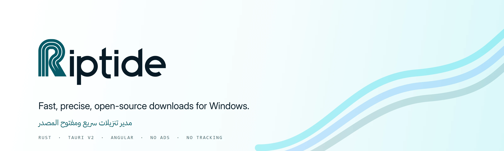
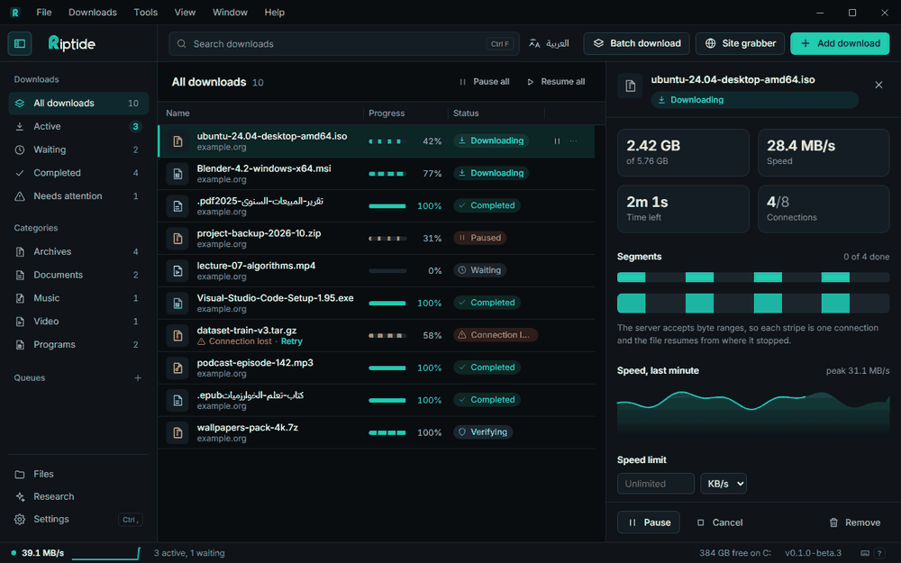
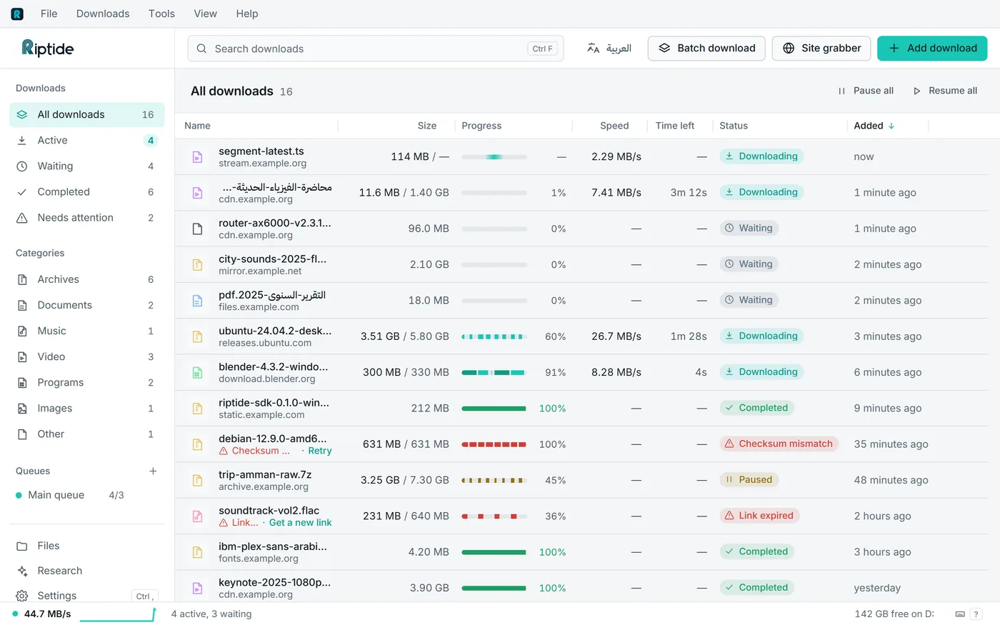
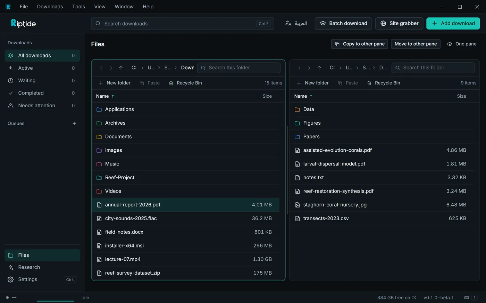
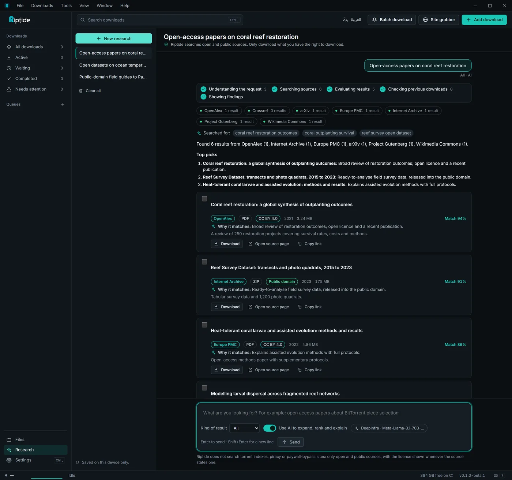
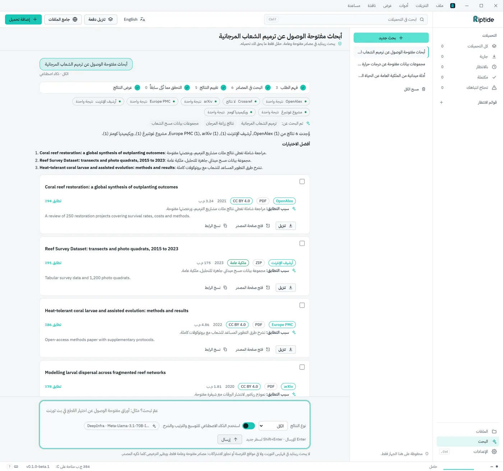

<p align="center">
  
</p>

<p align="center">
  
  
  
  <a href="#license"></a>
</p>

<h3 align="center">A fast, free download manager for Windows.<br>No ads, no account, no admin rights.</h3>

<p align="center">
  <a href="#download"><b>Download</b></a> ·
  <a href="https://layanjarrar1.github.io/Riptide/">Website</a> ·
  <a href="#features">Features</a> ·
  <a href="#screenshots">Screenshots</a> ·
  <a href="#browser-extension">Browser extension</a> ·
  <a href="#build-from-source">Build</a> ·
  <a href="#بالعربي">بالعربي</a>
</p>

<p align="center">
  
</p>

> [!NOTE]
> Riptide is in **beta**. It is ready to use and to test, but not finished: keep an eye on important downloads and please [report bugs](https://github.com/LayanJarrar1/Riptide/issues).

## Why Riptide

- **Fast.** Splits each file over up to 32 connections and keeps every connection busy.
- **Exact.** A download is complete only when every byte arrived and the server's version of the file did not change. It resumes from the exact byte after a crash or a power cut.
- **Private.** No account, no telemetry, no ads. It does not need administrator rights.
- **Arabic and English.** A fully mirrored right-to-left interface, light and dark themes.

## Download

| | File | Notes |
|---|---|---|
| **Installer** | [`Riptide_0.1.0-beta.1_x64-setup.exe`](https://github.com/LayanJarrar1/Riptide/releases/download/v0.1.0-beta.1/Riptide_0.1.0-beta.1_x64-setup.exe) | Per-user install, no admin prompt |
| **Portable** | [`Riptide-0.1.0-beta.1-portable.zip`](https://github.com/LayanJarrar1/Riptide/releases/download/v0.1.0-beta.1/Riptide-0.1.0-beta.1-portable.zip) | Unzip anywhere; data stays next to the app |

Windows 10 or 11, 64-bit. Checksums and older versions are on the [Releases page](https://github.com/LayanJarrar1/Riptide/releases).

The installer is not code-signed yet, so Windows SmartScreen may warn the first time: choose **More info → Run anyway**. You can check the download against `SHA256SUMS.txt` on the release page.

Upgrading from an alpha build works in place. The database moves to a new format that older versions cannot open, so Riptide keeps a copy of the old one next to it (`riptide.sqlite.v<N>.bak`, without saved cookies or passwords).

## Features

- **Downloads:** segmented multi-connection downloads, resume, queues and schedules ("only at night", then sleep or shut down), batch patterns like `file[001-120].zip`, and a site grabber that respects `robots.txt`.
- **Video:** YouTube, Vimeo and many more sites, with a quality picker down to audio only.
- **BitTorrent:** magnet links and `.torrent` files, choose files before you start, per-file progress. Seeding is off unless you turn it on.
- **Research:** ask in a conversation and Riptide searches open and public sources (papers, books, music, video, software, images, datasets) and shows the licence of each result. Save a research as Markdown, export citations as BibTeX or RIS. An optional AI (your own key) ranks results and says why; it is off until you set it up, and each question sends only itself.
- **File manager:** two panes, drag and drop, Recycle Bin and folder colours.
- **Browser extension:** Chrome and Edge send downloads to Riptide, with a "Download this video" button.
- **Updates:** one check a day (you can turn it off), installed in one click.

## Screenshots

<p align="center"><sub>The real interface with sample data.</sub></p>

<table>
  <tr>
    <td width="50%"></td>
    <td width="50%"></td>
  </tr>
  <tr>
    <td align="center"><sub><b>Downloads.</b> Every stripe is one connection.</sub></td>
    <td align="center"><sub><b>Files.</b> Two panes, drag and drop.</sub></td>
  </tr>
  <tr>
    <td width="50%"></td>
    <td width="50%"></td>
  </tr>
  <tr>
    <td align="center"><sub><b>Research.</b> Steps, a summary and result cards.</sub></td>
    <td align="center"><sub><b>بالعربية.</b> الواجهة تنعكس بالكامل.</sub></td>
  </tr>
</table>

## Browser extension

Chrome and Edge load the extension from the folder Riptide ships, so there is nothing else to download:

1. In Riptide open **Settings → Integration** and press **Open extension folder**.
2. In the browser open `chrome://extensions` (`edge://extensions` in Edge) and turn on **Developer mode**.
3. Press **Load unpacked** and pick that folder.

It takes downloads automatically (with rules for size, file types and sites; hold **Alt** to skip), adds **Download with Riptide** to the right-click menu, and can grab all links or images on a page.

## Privacy

Riptide does not collect anything about you. Its own network calls are your downloads, the local connection to the browser extension, and a daily check for a new version (Settings turns it off). Research and the optional AI contact only the sources and the provider you use, and your API key stays in Windows Credential Manager. See the [privacy page](https://layanjarrar1.github.io/Riptide/privacy/).

## Build from source

You need stable Rust, Node.js 20+ and Visual Studio Build Tools with the C++ workload. No admin rights are needed.

```powershell
git clone https://github.com/LayanJarrar1/Riptide.git
cd Riptide\apps\desktop
npm install
node scripts\fetch-media-tools.mjs   # video support: pinned yt-dlp and FFmpeg, SHA-256 checked
npm run tauri dev

# installer and portable zip
npm run bundle
npm run bundle:portable

# the quality gate (from the repository root)
.\scripts\check.ps1
```

More: [User guide](guide/en.md) · [Architecture](ARCHITECTURE.md) · [Contributing](CONTRIBUTING.md) · [Security](SECURITY.md) · [Changelog](CHANGELOG.md).

## بالعربي

<div dir="rtl">

**ريبتايد** مدير تحميل مجاني ومفتوح المصدر لويندوز. يقسم كل ملف على اتصالات متعددة، ويكمل من البايت الذي توقف عنده بعد انقطاع الكهرباء أو إغلاق البرنامج.

- **مجاني بالكامل:** بدون إعلانات ولا حساب ولا تتبّع، وبدون صلاحيات مسؤول.
- **دقيق:** لا يعتبر التحميل مكتملًا إلا إذا وصلت كل البايتات ولم يتغير الملف على الخادم.
- **عربي وإنجليزي:** واجهة تنعكس بالكامل من اليمين إلى اليسار، ومظهر فاتح وداكن.
- **البحث:** اسأل في محادثة فيبحث ريبتايد في مصادر مفتوحة وعامة ويعرض ترخيص كل نتيجة، ويحفظ البحث كملف Markdown ويصدّر المراجع (BibTeX وRIS). الذكاء الاصطناعي اختياري وبمفتاحك أنت، ويرسل كل سؤال بمفرده فقط.
- **مدير ملفات** بنافذتين، **تورنت**، **فيديو**، **طوابير وجدولة**، و**إضافة للمتصفح**.

**التحميل:**
[المثبّت](https://github.com/LayanJarrar1/Riptide/releases/download/v0.1.0-beta.1/Riptide_0.1.0-beta.1_x64-setup.exe) ·
[النسخة المحمولة](https://github.com/LayanJarrar1/Riptide/releases/download/v0.1.0-beta.1/Riptide-0.1.0-beta.1-portable.zip) ·
[دليل الاستخدام](guide/ar.md)

**تثبيت الإضافة في كروم أو إيدج:** ١) في ريبتايد: **الإعدادات ← التكامل ← فتح مجلد الإضافة**. ٢) في المتصفح افتح `chrome://extensions` وفعّل **وضع المطوّر**. ٣) اضغط **Load unpacked** واختر ذلك المجلد.

> هذه نسخة **بيتا**: صالحة للاستخدام والتجربة لكنها ليست نهائية. المثبّت غير موقّع رقميًا بعد، فقد يحذّرك SmartScreen أول مرة: اختر **مزيد من المعلومات ← تشغيل على أي حال**.

</div>

## Contributing

Bug reports with steps to reproduce, fixes with tests and translation review are the most useful contributions right now. Start with [CONTRIBUTING.md](CONTRIBUTING.md). Security issues go through [SECURITY.md](SECURITY.md), not the public tracker.

## License

The desktop app, CLI, IPC crate, native host and browser extension are licensed under **GPL-3.0-or-later** ([`LICENSE`](LICENSE)). The engine crates are dual-licensed under **MIT** ([`LICENSE-MIT`](LICENSE-MIT)) **or Apache-2.0** ([`LICENSE-APACHE`](LICENSE-APACHE)) at your option; each crate's `Cargo.toml` states which applies. Third-party notices are in [`THIRD-PARTY-NOTICES.txt`](apps/desktop/src-tauri/THIRD-PARTY-NOTICES.txt).

Built on [Tauri](https://tauri.app), [Angular](https://angular.dev), [tokio](https://tokio.rs), [reqwest](https://github.com/seanmonstar/reqwest) and [rusqlite](https://github.com/rusqlite/rusqlite). Ships [IBM Plex Sans Arabic](https://github.com/IBM/plex) and [Inter](https://rsms.me/inter/) under the SIL Open Font License. Only download what you have the right to download.
